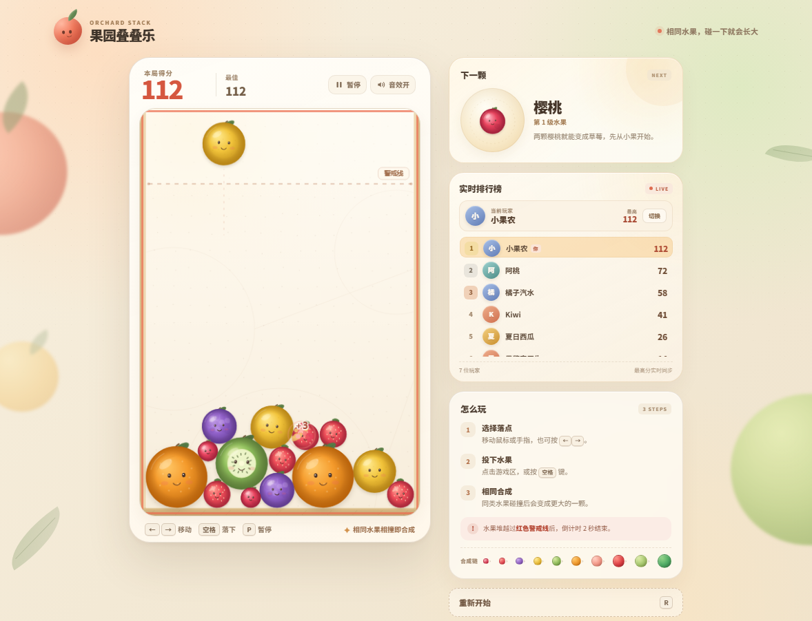
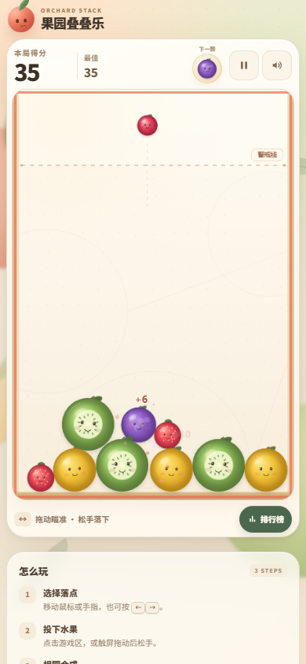

# 果园叠叠乐

一款使用 **HTML + CSS + 原生 JavaScript** 制作的水果合成小游戏，无框架、无图片素材、无外部依赖。

相同水果相撞后会合成更大一级的水果。果堆越过红色警戒线后进入 2 秒倒计时，倒计时结束即游戏结束；点击「再玩一次」或按 `R` 即可重新开始。

每位玩家可以设置自己的昵称，个人最高分会实时进入排行榜，并按分数自动排序。

## 运行方法

### 方式一：直接打开

保持 `index.html`、`styles.css`、`game.js` 在同一个文件夹中，双击 `index.html`，用现代浏览器（Chrome、Edge、Firefox、Safari）打开即可。

游戏不依赖网络、构建工具或本地服务器。

### 方式二：本地静态服务器（可选）

在 `fruit-merge` 文件夹中执行：

    python -m http.server 8000

然后访问 <http://localhost:8000>。

如果使用 Node.js 环境，也可以使用任意静态文件服务器指向该文件夹。

## 操作

| 操作 | 桌面端 | 手机 / 平板 |
| --- | --- | --- |
| 选择落点 | 移动鼠标，或按 `←` / `→` | 在游戏区移动手指 |
| 投下水果 | 点击游戏区，或按 `空格` | 拖动瞄准，松手落下；也可轻点游戏区 |
| 设置昵称 | 在开始面板输入昵称 | 在开始面板输入昵称 |
| 查看排行榜 | 右侧实时排行榜卡片 | 点击游戏下方「排行榜」按钮 |
| 切换玩家 | 点击排行榜中的「切换」 | 点击排行榜中的「切换」 |
| 暂停 / 继续 | 按 `P`，或点击右上角暂停按钮 | 点击右上角暂停按钮 |
| 重新开始 | 按 `R`，或点击「重新开始」 | 点击「重新开始」 |

## 规则

- 相同水果碰撞后会合成更大一级的水果，并获得分数。
- 水果合成顺序：樱桃 → 草莓 → 葡萄 → 柠檬 → 猕猴桃 → 橘子 → 水蜜桃 → 苹果 → 哈密瓜 → 西瓜。
- 水果堆越过红色警戒线后开始倒计时，持续 2 秒即游戏结束。
- 两颗西瓜相撞会直接爆开，获得 300 分。
- 每位玩家独立保存自己的最高分，昵称不区分大小写。
- 排行榜只记录每位玩家的历史最高分，本局分数超过自己的历史最高分时会立即刷新榜单。

## 手机端适配

- 游戏区会自动使用手机屏幕宽度，并收紧页面边距，让棋盘尽量完整落在首屏内。
- 顶部 HUD 会显示「下一颗」水果，无需向下滚动查看。
- 支持**拖动瞄准、松手落下**；拖动时会出现贯穿棋盘的落点辅助线。
- 手机端排行榜收纳为底部抽屉，点击游戏下方的「排行榜」按钮打开；打开时自动暂停游戏，关闭后继续。
- 暂停、音效和排行榜按钮使用更大的触控区域；昵称输入框使用 16px 字号，避免 iOS 聚焦时自动放大页面。
- 适配 `env(safe-area-inset-*)` 刘海屏安全区，并锁定横屏提示；横屏空间不足时会提示转回竖屏。
- 键盘快捷键仍然保留，桌面端布局不受影响。

## 排行榜说明

排行榜是**纯前端本机排行榜**：

- 数据保存在浏览器 `localStorage`，刷新或重新打开页面不会丢失。
- 同一浏览器的多个标签页之间，使用 `BroadcastChannel` 和 `storage` 事件实时同步排名。
- 不同浏览器、不同设备、不同用户之间不会自动共享数据。
- 如果需要真正的跨设备多人实时排行榜，需要增加后端接口或 WebSocket 服务；当前版本不依赖服务器，确保直接双击 `index.html` 即可运行。

音效开关、当前玩家和排行榜数据都会保存在本机。

## 文件结构

    fruit-merge/
    ├── index.html    页面结构、昵称输入、排行榜、玩家切换弹窗
    ├── styles.css    整体视觉、排行榜样式、响应式布局和动画
    ├── game.js       Canvas 绘制、水果物理、计分、排行榜与跨标签页同步
    ├── preview.png   桌面端画面预览
    ├── preview-mobile.png 手机端画面预览
    └── README.md     说明文档

## 实现要点

- **自写圆形物理**：水果使用圆形刚体，包含重力、墙体约束、两两碰撞、位置修正、法向冲量和切向摩擦。固定 120Hz 物理步长，避免不同刷新率导致手感差异。
- **合成规则**：碰撞检测阶段收集同级水果对，在物理步结束后统一合成，避免遍历数组时增删元素。
- **警戒线判定**：落下的水果有短暂保护时间；稳定后的水果若顶部越过警戒线，累积 2 秒倒计时，移回警戒线以下会取消危险状态。
- **绘制**：所有水果、叶片、表情、纹理由 Canvas 2D 程序化绘制，缩放时保持清晰；包含粒子、扩散圆环、飘分文字、屏幕轻震等反馈。
- **响应式**：桌面双栏、窄屏单栏；Canvas 按容器等比缩放，输入坐标会换算回内部逻辑坐标。手机端切换为紧凑 HUD、触屏手势和底部排行榜抽屉。
- **触屏交互**：Pointer Events 区分鼠标与触屏；触屏按下进入瞄准状态，移动更新落点，抬起才落下。
- **玩家与排行榜**：昵称会映射为稳定的玩家 ID；最高分按玩家合并保存，实时排序；多个标签页通过广播与本地存储事件同步。
- **音效**：使用 Web Audio API 即时合成，不需要音频文件。

## 可调参数

主要参数位于 `game.js` 顶部：

- `W` / `H`：逻辑画布尺寸。
- `LINE_Y`：警戒线高度。
- `DANGER_LIMIT`：越过警戒线后的倒计时秒数，默认 `2`。
- `SPAWN_DELAY`：两枚水果之间的投放间隔。
- `GRAVITY` / `RESTITUTION`：重力与弹性。
- `MAX_DROP_TIER`：可直接掉落的水果等级上限。
- `FRUIT_TYPES`：水果名称、半径、分数、配色、提示语。
- `MAX_PLAYER_NAME`：昵称最大字符数，默认 `12`。

## 本地数据

浏览器开发者工具中可以找到以下存储项：

- `orchard-stack-leaderboard-v1`：所有玩家的最高分记录。
- `orchard-stack-player-name-v1`：当前玩家昵称。
- `orchard-stack-sound-v1`：音效开关。
- `orchard-stack-best-v1`：旧版本的最高分，会在首次升级时迁移到排行榜。

## 浏览器要求

推荐使用近两年的 Chrome、Edge、Firefox 或 Safari。需要支持 Canvas 2D、Pointer Events、Web Audio API 和 `localStorage`；`BroadcastChannel` 不可用时会自动退回到 `storage` 事件同步。不支持本地存储的旧浏览器仍可游玩，但排行榜只在当前会话内生效。
